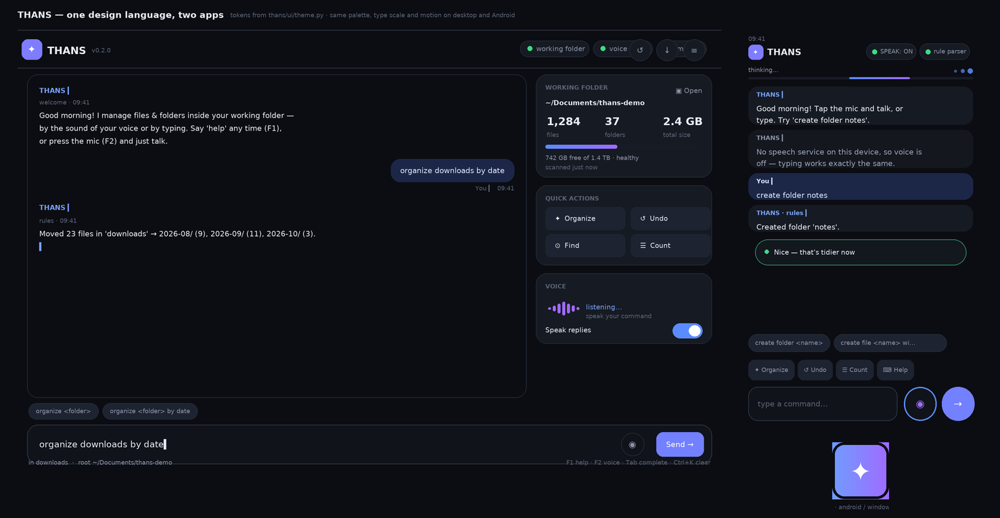

# THANS — Offline Voice & Text File Assistant

A **100 % offline** assistant for **desktop (Python + tkinter)** and **Android
(Kivy)** that lets you **access, alter, create and organize files & folders** by
*speaking* or *typing* natural commands. No cloud, no accounts, no internet
after the one-time model download.



```
You:  "create folder project reports in work"
THANS: Created folder 'work/project reports'.

You:  (voice) "organize downloads by date"
THANS: Moved 23 files into 4 folders in 'downloads'.
```

## How it works

| Layer | Technology | Model size | Internet? |
|-------|-----------|-----------|-----------|
| Speech → text | **Vosk** (small EN-US model, live partial + RMS level) | ≈ 40 MB | only to download once |
| Text → speech | **pyttsx3** (OS voices: SAPI5 / NSSpeech / espeak) | 0 MB | never |
| Command parsing | **Rule parser + Live Intent Preview** (instant, zero deps) | 0 MB | never |
| Free-form parsing | **Optional tiny LLM** via llama.cpp (GGUF in `models/`) | ≈ 408 MB default | only to download once |
| Desktop UI | **tkinter** (60fps Sonic Visualizer, Live File Sidebar, Dark/Light themes) | 0 MB | never |
| Android UI | **Kivy** (Animated cards, Sonic Wave bar, Chat + Visual File Explorer tabs) | 0 MB | never |

The rule parser handles **every command in the reference below** without any
model, so the app is fully functional even before models are downloaded.
The small LLM (default **Qwen2.5-0.5B-Instruct Q4_K_M**) is optional sugar for
loose phrasing — it is switched off by default and can be enabled in Settings.

## Minimalistic UI, UX & Animations (Desktop & Android)

* **60fps Sonic Visualizer:** Multi-ribbon sine wave + breathing orb in the header that dynamically responds to **Idle**, **Listening** (live microphone RMS amplitude), **Thinking**, **Speaking**, and **Success/Error** states.
* **Real-Time Intent Preview Pill:** As you type, THANS previews the exact parsed action (`📁+ Create folder 'work'`, `♻️ Delete 'todo.txt' · moves to .thans_trash`) before you even press Enter.
* **Smart Autocomplete (`Tab` / `⚡ Complete`):** Completes command starters (`cre` → `create folder `) and live filenames from the active folder.
* **Live File Workspace Inspector & Diff Pulse:** Interactive split-pane sidebar (Desktop) and `📁 Files` tab (Android) with instant filtering, smart file-type icons, human-readable sizes, double-click navigation, and an **animated emerald highlight pulse** on newly created or modified items.
* **Interactive Breadcrumbs & Quick-Action Chips:** Navigate folders via clickable breadcrumbs (`🏠 root › work › reports` or `⬆ Up`) and trigger common actions (`📁 List`, `➕ Folder`, `📝 File`, `✨ Organize`, `🔍 Find`, `↩ Undo`, `❓ Help`) with one tap.
* **Curated Dark & Light Themes:** Smooth cross-fade transition (`☀️ / 🌙` or `Ctrl+T`).
* **Keyboard Shortcuts (Desktop):** `Ctrl+K` focus input · `Tab` autocomplete · `Ctrl+Z` undo · `Ctrl+B` toggle file sidebar · `Ctrl+T` toggle theme · `Ctrl+L` clear chat · `F2` toggle voice mic.

## Design system

One palette, one set of easings, one geometry source for both apps:
**`thans/animations.py`** (dark *and* light themes, `lerp_color`, easings, the
sonic-wave geometry, the streaming chunker) and **`thans/ui_helpers.py`**
(breadcrumbs, directory snapshots, file icons/sizes, quick chips, the live
intent preview and autocomplete). Both are GUI-free and fully unit-tested, and
the Android app imports the very same modules — so the phone UI cannot drift
from the desktop palette.

`python scripts/render_ui_preview.py` renders the picture at the top of this
file *from those tokens*, so the screenshots in the docs cannot go stale.

## Headless & scriptable

No window, no display, no microphone needed — the same engine is available on
the command line (handy for servers, cron jobs and scripts):

```bash
python -m thans --run "organize downloads by date"        # run one command
python -m thans --run "create folder reports" --run "list" # run several in order
python -m thans --run "find invoice" --json               # one JSON object per command
python -m thans --cli --root ~/work                       # interactive prompt
```

Contract: results go to **stdout**, problems to **stderr** (prefixed `THANS: `),
and the exit code is `0` only if every command succeeded — so `thans --run … &&
next_step` works in a shell script. Headless modes never read or write your
saved config unless you pass `--root`.

## Quick start

```bash
# 1) install dependencies
python -m pip install -r requirements.txt            # core (voice UI)
python -m pip install -r requirements-llm.txt        # optional LLM

# 2) download offline models once (needs internet this one time)
python scripts/download_models.py                    # ~450 MB total

# 3) run
python -m thans
#   --root <folder>   set working root (default: your home)
#   --text-only       start without microphone
#   --no-tts          mute the spoken replies
#   --models          show which models are installed
#   --selftest        run the built-in test suite (headless)
#   --run "<cmd>"     run a command without any window (repeatable)
#   --cli             interactive prompt without any window
#   --json            machine-readable output for --run
```

Debian/Ubuntu: `sudo apt install python3-tk` first (tkinter).

## Command reference (voice or text)

| Command | Example |
|---------|---------|
| List | `list` · `show files` · `show reports in work` · `what's in downloads` |
| Create folder | `create folder work/reports` · `make a folder called ideas in notes` |
| Create file | `create file todo.txt` · `create file memo.txt with meeting at 3 in notes` |
| Rename | `rename old.txt to new.txt` |
| Move | `move report.pdf to work` · `move a.txt into docs` |
| Copy | `copy report.pdf to backups` |
| Delete | `delete old.txt` (→ trash; say `undo` to restore) · `delete old.txt permanently` |
| Count | `how many files in docs` · `count files` · `number of folders here` |
| Open | `open notes` (opens in default app / file manager) · `show in folder report.pdf` |
| Organize | `organize downloads` (by extension) · `organize downloads by date` |
| Search | `find invoice` · `search for pdf files` · `find *.log` · `find logo.png in assets` |
| Navigate | `go to work` · `cd work/reports` · `cd` (back to root) · `go up` |

Say **"here"** or **"."** to mean the folder you are standing in
(`organize .`, `list this folder`, `how many files in .`) and **"in <folder>"**
to point at another one (`find invoice in docs`).

Deletes go to `.thans_trash` inside your working root by default — nothing is
destroyed unless you explicitly say *permanently* (or enable it in Settings).
All operations are confined to the working root; THANS refuses to touch paths
outside it.

## Models folder

All models live in the dedicated **`models/`** folder (see `models/README.md`):

```
models/
├── vosk-model-small-en-us-0.15/            ← speech recognition (~40 MB)
└── qwen2.5-0.5b-instruct-q4_k_m.gguf       ← optional LLM (~408 MB)
```

`python scripts/download_models.py` fetches both (progress bars, skips existing
files). Smaller or larger LLMs are selectable with `--model` — see the script's
`--list`. After the download THANS needs **no internet at all**.

## Installer

### Windows
1. `installer\windows\build_exe.bat` — builds `dist\THANS.exe` (PyInstaller)
   and, if [Inno Setup](https://jrsoftware.org/isdl.php) is installed, compiles
   `installer/windows/setup.iss` into **`installer/windows/Output/THANS-Setup-0.2.0.exe`**
   (classic wizard: pick folder, desktop shortcut, uninstaller).
   Download models first (`python scripts/download_models.py`) and they are
   bundled into the installer; otherwise the installed app offers one-click download.
2. No Inno Setup? `dist\THANS.exe` + the `models/` folder next to it is a
   working portable app — copy anywhere, double-click, done.

License: MIT (`LICENSE`). Release notes: `CHANGELOG.md`.

### Linux
```bash
installer/linux/build_exe.sh     # builds dist/THANS
installer/linux/install.sh       # installs to /opt/thans + launcher (thans.desktop)
```

### macOS
`python -m venv .venv && . .venv/bin/activate && pip install -r requirements.txt`
then `python -m thans`. (A DMG can be produced the same way with PyInstaller.)

### Android (APK)
A Kivy port of the **same app** lives in [`android/`](android/README.md).
Fastest path to the APK:

1. GitHub repo → **Actions** tab → **Build Android APK** → **Run workflow**.
2. Download the **`thans-android`** artifact when the job finishes → install the `.apk`.

Text commands work fully offline on the phone; voice input/replies use the
device's own speech service (best-effort — see `android/README.md` for the
capability matrix and local buildozer instructions).

## Project layout

```
thans/            the app (GUI, engine, parsers, actions, audio)
thans/animations.py  themes, easings, sonic-wave geometry, stream chunker
thans/ui_helpers.py  breadcrumbs, dir snapshots, icons, intent preview, autocomplete
thans/cli.py      headless runner (no tkinter import) behind --run / --cli
thans/actions/    file & folder operations (safety-checked)
models/           dedicated folder for all offline models
scripts/          download_models.py, build_installer.py
installer/        Windows (Inno Setup) and Linux installer sources
tests/            unittest suite (run: python -m thans --selftest)
PROGRESS.md       50-step build plan + live status (resumable build log)
```

## Safety model

- **Working root confinement:** every resolved path must stay inside the chosen
  root (relative, `~`, or absolute). Escapes (`../`, other drives, symlinks
  out of root) are rejected.
- **Trash first:** deletes move to `<root>/.thans_trash` and are restorable with
  `undo` (or by hand, the folder is plain).
- **Audit:** the last action is recorded so `undo` can reverse rename / move /
  copy / create / delete.
- **Config** lives in `~/.thans/config.json` — inspect it any time.

## Development

```bash
python -m thans --selftest          # full suite: parser, actions, engine, CLI, UI
python scripts/render_ui_preview.py # regenerate docs/ui-preview.png
```

The suite (100+ tests) runs **without a display**: the UI layers are exercised
through faithful test doubles of tkinter (`tests/faketk.py`) and Kivy
(`tests/fakekivy.py`) that validate option names, run the real animation loop
on a virtual clock and drive real worker threads. Android-specific checks parse
`android/thans.kv` and prove every `app.*` handler and every widget id that the
Python code touches actually exists.

## Works with

* **Windows 10/11** — portable `THANS.exe` or the Inno Setup wizard (desktop +
  Start-menu shortcuts, icon, uninstaller)
* **Linux** — PyInstaller build + `install.sh` (launcher, `.desktop` entry, icon)
* **macOS** — `pip install -r requirements.txt && python -m thans`
* **Android 5.0+** — `android/` Kivy port; APK from GitHub Actions or buildozer
* **Anything headless** — `thans --run "…"` / `thans --cli`
